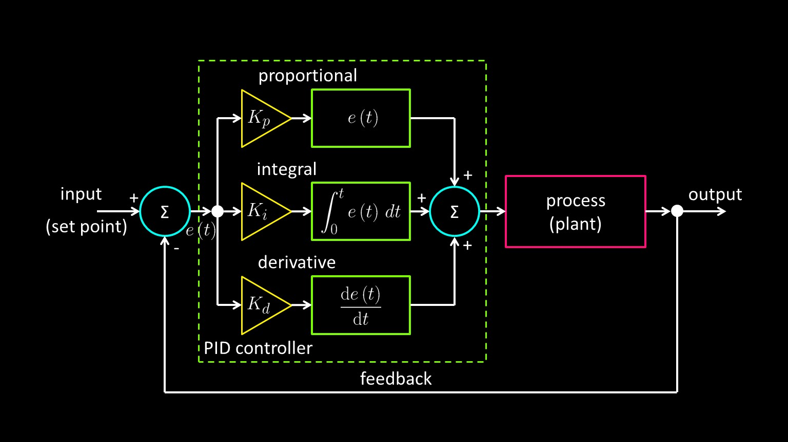

<h1>PID_C</h1>

PID Controller Library in C

A lightweight C library for implementing PID (Proportional–Integral–Derivative) control algorithms in embedded systems and general-purpose applications.

<h2>Overview</h2>

This library provides a simple way to calculate PID control outputs using a reference value (setpoint) and a measured value (process variable).

The PID controller continuously calculates the error between the desired and measured values, generating a control output that helps the system reach and maintain the target value.

It can be used in applications such as:

◆ Motor speed and position control

◆ Temperature regulation

◆ Robotics and automation systems

◆ Embedded systems using microcontrollers

◆ Process control and feedback systems

<h2>Installation</h2>

  Copy the library source and header files into your project:

  <h3 align="left">📂project/</h3>
  
├────────────────────────────── pid.c

  
└────────────────────────────── pid.h

<h3>Include the header file in your source code:</h3>

#include "pid.h"

<h3>Compile the library together with your application:</h3>

gcc main.c pid.c -o application

<h2>License</h2>

This project is licensed under the MIT License. See the <a href="LICENSE">LICENSE</a> file for details.

